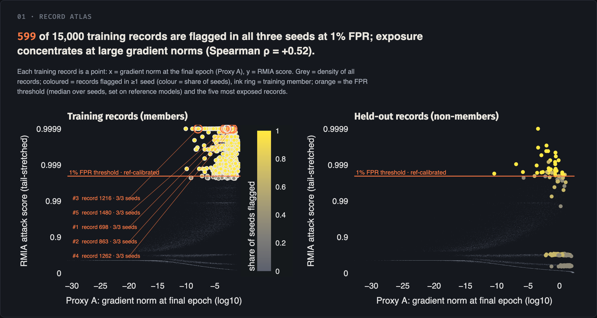

# LeakAtlas

**Which training records does a model leak through membership inference, whose records are they, and could a
cheap, attack-free signal have warned us in advance?**

LeakAtlas audits every training record of small Adult and Fashion-MNIST models under five defenses, stores
per-record attack scores, losses and gradient norms in DuckDB, tests whether two attack-free proxies predict
which records (and which demographic subgroups) are exposed, and presents it all in a linked, explorable
dashboard where changing the seed, defense, ε or FPR shows whether "this record is at risk" survives.

CIS 545 Data Security & Privacy, University of Michigan-Dearborn.



Results with confidence intervals: **[results/summary.md](results/summary.md)** (generated from the stored data,
no hand-typed numbers).

## Research question

Can attack-free proxies, (A) the per-sample gradient norm at the end of training (Tobaben et al.) and (B) the loss
ratio (Jebreel et al.), predict which records and subgroups are most exposed well enough for a compliance reviewer
to triage risk without running a full attack? And how does each defense reshape that per-record risk map, not just
the average?

## Threat model

| | |
|---|---|
| **Attacker access** | Black-box query access to the target model's outputs (per-class probabilities), nothing else: no weights, gradients or training code beyond the public recipe. |
| **Attacker knowledge** | Shadow data from the same distribution as the training data (a disjoint pool), used to train reference models with the same recipe as the target, plus a population sample for RMIA. Thresholds are calibrated on those reference models only, never on the target's members (realistic-LiRA protocol). |
| **Protected information** | Whether a specific record was in the training set (membership). For Adult this links a person's census record to the training set; subgroup attributes (sex, race, age band) are analysed for disparate exposure. |
| **Trust boundary** | The model's prediction interface. Everything behind it (training data, weights, MIAShield's exclusion oracle, DP noise) is trusted; everything that crosses it (queries and returned probabilities) is attacker-observable. |
| **Defender** | Can measure the attack-free proxies (it owns its training data and a hold-out) and apply a defense: anti-overfitting training, DP-SGD (ε ∈ {1, 4, 8}, δ = 1/N, RDP accountant) or a MIAShield ensemble. |
| **Out of scope** | White-box and label-only attacks, adaptive attacks against MIAShield's oracle, data poisoning, attribute inference. |

## What is built

| Stage | Module | What it does |
|---|---|---|
| Data | `src/leakatlas/data.py` | UCI Adult (45,222 rows after dropping missing values, CC BY 4.0) and Fashion-MNIST (70,000 images, MIT); preprocessing and subgroup labels. |
| Models | `src/leakatlas/models.py` | MLP (Adult) and small CNN (Fashion-MNIST), no BatchNorm (Opacus-compatible). |
| Defenses | `src/leakatlas/defenses.py` | Fixed target/shadow/population split; overfit baseline, anti-overfitting (weight decay + label smoothing + early stopping), DP-SGD (Opacus, RDP), MIAShield (5 disjoint sub-models + exact-signature exclusion oracle); resumable training cache. |
| Attacks | `src/leakatlas/attacks.py` | RMIA and LOSS through ML Privacy Meter's `attacks.py` (pinned submodule, unmodified); reference-only threshold calibration; underflow-free log-loss and per-sample log gradient norms (torch.func). |
| Store | `src/leakatlas/store.py` | DuckDB, one row per record × configuration × seed; Pydantic row schemas; Polars for analysis. |
| Proxies | `src/leakatlas/proxies.py` | Proxy evaluation (tuned on seed 0 × dev records, evaluated once on seeds 1–2 × test records), stability across seeds, Adult subgroup gaps with bootstrap CIs. |
| Analysis | `src/leakatlas/analysis.py` | Per-configuration privacy/utility/cost table and `results/summary.md`, all from queries. |
| Dashboard | `src/leakatlas/viewer.py`, `theme.py` | Panel + HoloViews/Bokeh + Datashader; 7 linked views, one editorial theme ([design notes](docs/design_principles.md)). |

Recon notes on the tools (verified from source): [docs/tool_notes.md](docs/tool_notes.md). Pipeline design and
compute plan: [docs/architecture.md](docs/architecture.md).

## Setup

Python 3.12, [uv](https://docs.astral.sh/uv/). CPU or Apple-silicon MPS; no CUDA needed.

```bash
git clone --recurse-submodules https://github.com/spacedust10/leakatlas
```
```bash
cd leakatlas && uv sync
```
```bash
uv run playwright install chromium
```

The datasets are downloaded on first use into `data/raw/` (gitignored).

## Commands

| Command | What it does | Time (M3 Pro) |
|---|---|---|
| `make train` | Full pipeline: train every target and reference model, audit, analyse, render figures. | ≈ 2.5 h training + ≈ 15 min audit/analysis |
| `make reproduce` | Rebuild every table, `results/summary.md` and every figure **from `data/leakatlas.duckdb` only** (no training, no network). | ≈ 6 min |
| `make serve` | Open the dashboard: `panel serve src/leakatlas/viewer.py`. | instant |
| `make test` | Check the underflow-free gradient-norm computation against float64 autograd. | ≈ 1 min |

Dashboard views are addressable by URL, e.g. `/viewer?dataset=adult&defense=dp&eps=4&seed=all&fpr=0.01&record=6620`.
